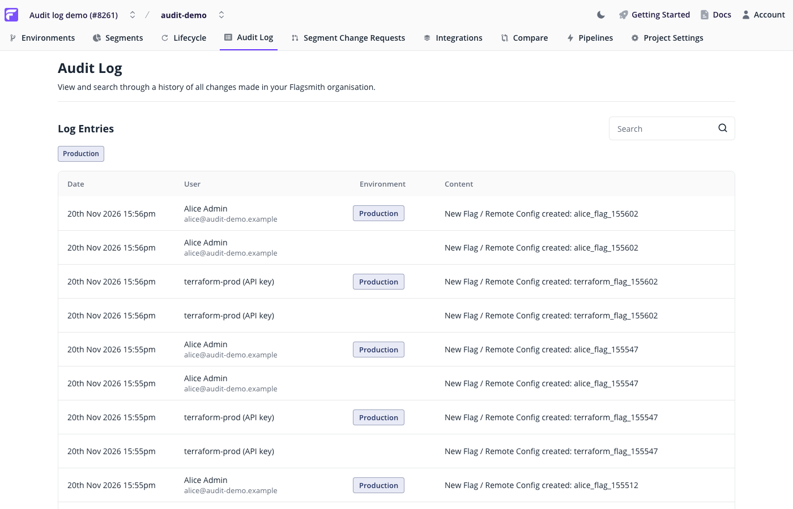

# Sample apps: proof for #8721 and #8261

Each fix has its own branch, which holds only the change:

| Issue | Branch | What it fixes |
|---|---|---|
| [#8721](https://github.com/Flagsmith/flagsmith/issues/8721) | `fix/ld-importer-segment-or-8721` | The LaunchDarkly importer joined segment rules with AND instead of OR |
| [#8261](https://github.com/Flagsmith/flagsmith/issues/8261) | `fix/audit-log-attribution-8261` | The audit log didn't show which Master API key made a change |

This branch (`sample-apps`) holds the small sample apps used to show each fix working end to end, along with their recorded output.

## Test results

| | #8721 | #8261 |
|---|---|---|
| Unit tests for the changed area | 75/75 LaunchDarkly tests pass | Audit API tests pass; 98/98 audit-log Jest tests pass |
| Full API test suite (`make test`) | 5,860 passed. The 2 failures were in `segment_membership`, which this fix doesn't touch, and pass when run on their own (order-dependent flakes). | 5,854 passed. The 1 failure was in `oauth2_metadata`, which this fix doesn't touch, and passes when run on its own. |
| Diff coverage | 100% (111 lines) | 100% (32 lines, backend); `getAuditLogAuthor.ts` 100% |
| mypy strict / pre-commit | clean / pass | clean / pass |
| Frontend tsc / ESLint | n/a | no new errors / 0 errors |

---

## #8721: LaunchDarkly segments imported as AND instead of OR

**The bug.** In LaunchDarkly, a user is in a segment if they are on the included list. Otherwise they are out if they are on the excluded list. Otherwise they are in if **any** rule matches. The importer put every rule into one ALL group, so a user had to match **every** rule at once, and almost nobody got in.

**Sample app** (`launchdarkly-8721/`). The LaunchDarkly segment "Beta testers" has:
- included user: `vip-user`
- excluded user: `blocked-user`
- rule 1: `email endsWith @acme.com`
- rule 2: `country in NL, BE`

The demo runs the **real** Flagsmith importer. Only LaunchDarkly's HTTP API is stubbed, and the stub returns `ld_fixtures/`. It then adds a feature `beta-checkout` that is off by default and on for the imported segment. Finally it asks the Flagsmith SDK API for that flag for 6 users.

```
user          email            ctry | LaunchDarkly | old import | fixed import
alice         alice@acme.com   US   | ON           | off ❌      | ON  ✅
bob           bob@gmail.com    NL   | ON           | off ❌      | ON  ✅
carol         carol@acme.com   BE   | ON           | off ❌      | ON  ✅
dave          dave@gmail.com   US   | off          | off ✅      | off ✅
vip-user      vip@gmail.com    US   | ON           | off ❌      | ON  ✅
blocked-user  x@acme.com       NL   | off          | off ✅      | off ✅
matches LaunchDarkly: old 2/6, fixed 6/6
```

The imported segment rules are in `import_old.json` and `import_fixed.json`:
- **old:** `ALL[ ANY email, ANY country, ANY key=vip-user, NONE key=blocked-user ]`
- **fixed:** `ANY[ ALL email, ALL country, ALL key=vip-user ]` and `ALL[ NONE key=blocked-user ]`

**Run it** (needs a local Flagsmith database, plus one checkout of `main` and one of the fix branch):

```bash
cd sample-apps/launchdarkly-8721
python3 make_fixtures.py   # optional: regenerates ld_fixtures/
export OLD_CHECKOUT=/path/to/flagsmith-main FIXED_CHECKOUT=/path/to/flagsmith-8721
export ENV_FILE=/path/to/flagsmith/api/.env-local   # optional
./import.sh old && ./import.sh fixed
# start the API on :8000 (`make serve` in either checkout), then:
python3 sample_app.py
```

---

## #8261: audit log doesn't show which Master API key made a change

**The bug.** A change made with a Master API key (for example by Terraform or CI) is saved with that key on the audit log record. The audit log API never returned the key, though, so the dashboard's User column was blank for those changes.

**The fix.** The audit log list and detail endpoints now return the key's name and its short public prefix. The secret key itself is never returned.

```jsonc
// before
{ "log": "New Flag created: terraform_flag", "author": null }
// after
{ "log": "New Flag created: terraform_flag", "author": null,
  "master_api_key": { "prefix": "DF9FJs9L", "name": "terraform-prod" } }
```

The dashboard shows such entries as **`terraform-prod (API key)`**.

**Sample app** (`audit-log-8261/`). The setup creates an admin user Alice and a Master API key `terraform-prod`. The sample app creates one flag with the API key and one with Alice's token. It then reads the organisation audit log from an old API (`main`, port 8001) and a fixed API (fix branch, port 8000).

```
OLD   terraform_flag | author=null | master_api_key=<field absent> | UI shows: (blank)
FIXED terraform_flag | author=null | master_api_key={"prefix": "DF9FJs9L", "name": "terraform-prod"} | UI shows: terraform-prod (API key)
both  alice_flag     | author=yes  | UI shows: Alice Admin
```

The screenshot of the real dashboard on the fix branch is at `audit-log-8261/screenshots/audit-log-fixed.png`.



**Run it:**

```bash
# Audit logs are hidden on the free plan. For a local demo only:
touch /path/to/checkout/api/ENTERPRISE_VERSION   # do not commit this file
cd /path/to/flagsmith-8261/api
DEMO_DIR=/path/to/sample-apps/audit-log-8261 \
  python manage.py shell -c "exec(open('/path/to/sample-apps/audit-log-8261/setup.py').read())"
# start the fixed API on :8000 and an API from main on :8001, then:
python3 /path/to/sample-apps/audit-log-8261/sample_app.py
# optional screenshot (dashboard on :8080 via `ENV=local npm run dev`, needs Playwright):
node /path/to/sample-apps/audit-log-8261/screenshot.mjs
```

`setup.py` writes `setup.json` with local-only demo credentials. It is ignored by git.
